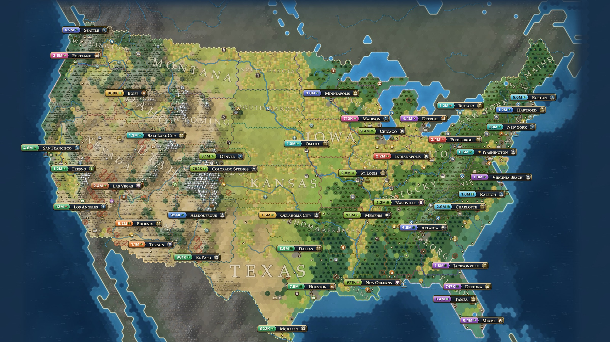
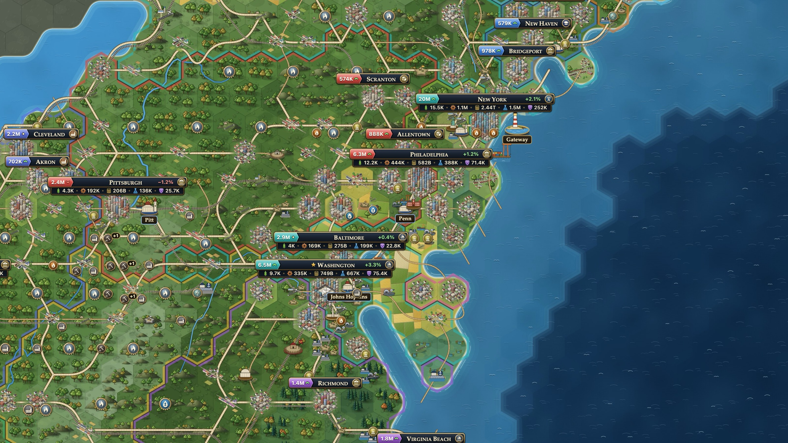
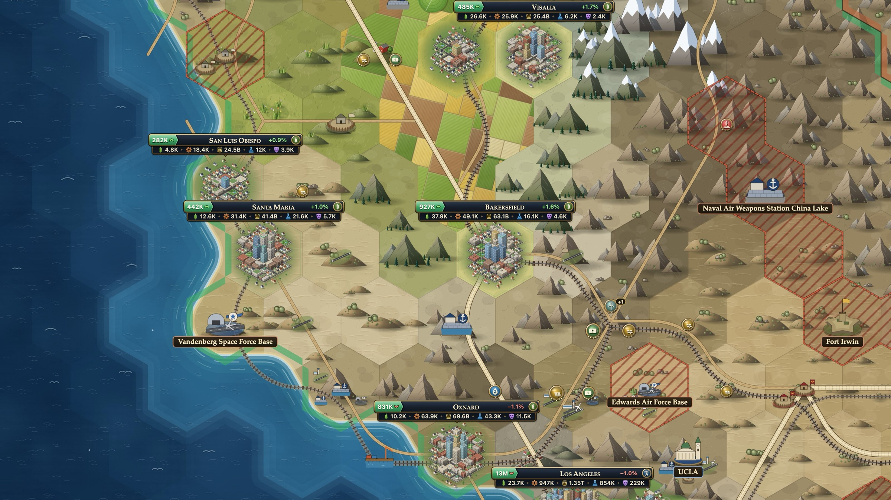
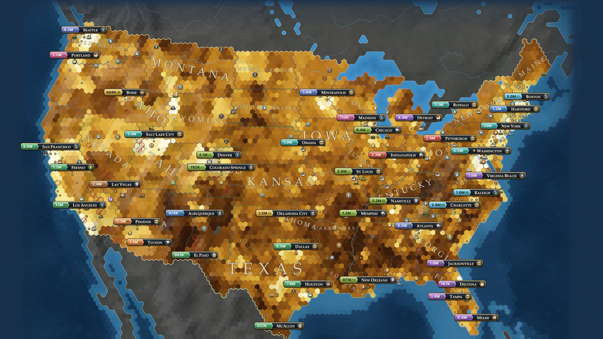

# EarthCiv: real countries as strategy maps, built from public data

**Live: [earthciv.org](https://earthciv.org/)** · [United States](https://earthciv.org/?country=us) ·
[Canada](https://earthciv.org/?country=ca) · [Add your map](#add-your-map)



EarthCiv draws real countries like a turn-based strategy map, from public data: terrain, cities, resources, roads
and more, with every number traced to its source. It is a visualizer, not a game.

- **It opens on a world map that lists the maps made in this style:** more than 60 maps of more than 50 countries
  and territories. More than 50 people built most of them in the day after usaciv was announced. Each of their maps
  carries its author's name and, where its code is on GitHub, a link to the repository. Most of those with a live
  site open inside EarthCiv.
- **Two countries are EarthCiv editions,** drawn by the map engine in this repository: the
  [United States](#the-united-states-edition) and [Canada](#canada-edition).
- **Every map names the person who made it,** with their picture: on its card, on the button that opens it and
  above the map while it is open. [Map makers](https://earthciv.org/#makers=all) lists everyone who made one.

EarthCiv grew out of [usaciv](https://karpathy.ai/usaciv) by Andrej Karpathy
([announcement](https://x.com/karpathy/status/2125779541952246039),
[original source code](https://karpathy.ai/usaciv/usaciv-source.zip)). His map of the United States is the first
edition here, and the Canada edition and the world map are built on his code.

## Add your map

If you built a map of a country, a region or a city in this style, it belongs on the
[world map](https://earthciv.org/). The list came from GitHub searches on November 26 and 27, 2026, so your map may
already be there. The search box at the top of the world map finds a map by its name, its author or
its repository's name (`owner/name`, not the full address).

- **Not listed, or listed with a mistake?**
  [Fill in the map form](https://github.com/earthciv/earthciv/issues/new?template=add-your-map.yml). It asks for
  the map's name, its repository, its live address if it has one, and the places it covers. Use the same form to
  have a map taken off the list. The world map's own "Add its link" saves a link in your browser only.
- **Prefer a pull request?** Add or edit your entry in [`web/data/ports.json`](web/data/ports.json); its fields are
  described below. If the number of entries changes, set `CATALOG_PORT_COUNT` in `web/js/ext/ports/index.js` to
  the new number. Then run `uv run python -m unittest tests.test_ports`, which checks every entry.
- **Nobody has mapped your country yet?** Build the map, publish it anywhere, and add it the same way. Most authors
  started from [usaciv's source code](https://karpathy.ai/usaciv/usaciv-source.zip), which maps one country. This
  repository holds that code reworked to draw several: [How it works](#how-it-works) describes the pipeline that
  turns public data into the files the map draws, and [Editions](#editions) and
  [docs/EDITIONS.md](docs/EDITIONS.md) give the format a country follows to run on EarthCiv's own engine, as the
  United States and Canada do.

EarthCiv only points to your map. Your code and data stay in your repository, under your name and your licence.

<details>
<summary>The fields of an entry in the list</summary>

```json
{
  "id": "ptciv",
  "name": "Portugal (ptciv)",
  "emblem": "🇵🇹",
  "status": "live",
  "scope": "country",
  "region": "Europe",
  "countries": ["PT"],
  "center": [-8.0, 39.6],
  "languages": ["pt", "en"],
  "license": "MIT",
  "repo": "your-name/ptciv",
  "author": "your-name",
  "url": "https://your-name.github.io/ptciv/",
  "embed": true,
  "description": "Portugal as a hex strategy map, built from INE and Eurostat open data."
}
```

- `id` is unique: lowercase letters, digits and hyphens.
- `status` is `"live"` for a map with a public `https` address in `url`, and `"repo"` (with `"url": null`) for a map
  that has only source code. The two EarthCiv editions' own entries use `"merged"`, with an `editionId`.
- `embed` says whether EarthCiv may show your site in a frame on its own page. Use `false` to have your site open
  in a new tab instead, or if your host does not allow framing. A map shown in a frame is also listed in the map
  menu at the top left of every edition and of every other map shown this way.
- `scope` is `"country"`, `"multi"` (several countries) or `"region"` (part of a country, such as a region or a
  city).
- `countries` holds the codes of the outlines the world map draws: each country's ISO 3166-1 alpha-2 code, in
  capitals, and `XK` for Kosovo. The test names any code that has no outline. Such a territory takes its country's
  code, with `scope` `"region"`.
- `center` is `[longitude, latitude]`, where the map's pin is drawn. If the country already has a map, place yours
  a little apart from its pin.
- `region` is the part of the world the map belongs to, such as `Europe` or `Middle East`.
- `languages` holds the codes of the languages the map's text is in, such as `pt` or `zh-TW`.
- `repo` is `owner/name` on GitHub, or `null` for a live map whose code is not there. `license` is the licence the
  map's repository states, or `null`.
- `author` is the name your map is credited to. The world map shows it wherever it shows the map, with your
  picture and a link to your GitHub profile, both taken from the account that owns `repo`, and lists your maps
  together under [Map makers](https://earthciv.org/#makers=all). `https://earthciv.org/#makers=` followed by that
  account's name opens the list at your entry. Two more fields are for when that account is not yours, and are
  left out otherwise: `author_github`, your GitHub account (for a map with no repository, or one kept in an
  organization's), and `author_url`, an `https` page of your own for your name to link to instead of the
  profile. With `"author_github": null` you are credited by name alone, with no picture and no profile link.
- `author_twitter` is your optional Twitter / X handle, without `@`. It appears beside your creator credit and on Today’s map when featured. Use the map submission form to add or update it for an existing listing.
- `author_twitter_source` records the public profile or personal site that confirms a discovered handle.
- `github_stars` and `github_stars_checked` hold the repository’s star count and the UTC date it was checked with GitHub’s repository API. The count links to the repository’s stargazers beside visitor ratings.
- `featured_creator: true` puts that map’s maker and their maps in the home panel’s featured creator section.
- `based_on` optionally names another catalog entry whose original work this map builds on. Its creator is credited on the map card.
- `emblem` is one emoji, usually a flag. `name`, `author` and `description` are plain text.

</details>

## The United States edition

This is the map usaciv began with: the **real** United States drawn like a turn-based strategy map. Hex terrain comes
from elevation and land-cover data. Cities have yield banners built from GDP and job counts. Resources are real
power plants, mines and shale plays. Roads, railroads, ports, forts and wonders sit on the tiles. There are lenses,
a City View with citizens and districts, and a council of Advisors for slicing the data. Every number traces back
to a public source in the in-app **Almanac**.

It is a static site built with plain ES modules and Canvas 2D, with no framework or npm. The data is built
by a small Python pipeline that uses only the standard library, from public downloads that need no API keys.

<table>
  <tr>
    <td></td>
    <td></td>
  </tr>
  <tr>
    <td></td>
    <td></td>
  </tr>
</table>

### What's in it

- **The map.** Painted hex terrain: forests, crop patchwork, wooded hills, snowy ranges, Great Basin ranges and
  playas, Colorado Plateau mesas, marsh and suburbs. Coasts and lakes are smoothed. There are rivers and state
  colours. Cities grow from villages into skylines across several hexes. All art is drawn in code.
- **Yields.** The top bar and the city banners show Food, Production, Gold, Science and Culture. Gold is GDP from BEA.
  The others are job counts by industry from the ACS. Click a yield for a report with leaderboards.
- **Tile improvements.** Interstates and major highways, railroads, the principal ports (ranked by tonnage) and the
  busiest airports. Turn them on and off from the **Map** menu.
- **Military.** DoD installations are drawn as forts, one glyph per service, and the largest ranges as restricted
  ground. The Military advisor has troops and defense dollars by state.
- **Wonders.** 52 wonders, each chosen by a published rule: the most-visited national parks, the R1 universities
  with the most R&D, and a set of landmarks.
- **Trade routes.** The largest interstate freight flows between metro areas (FAF5) are drawn as caravan arcs.
- **Lenses.** Colour every county by income, degrees, poverty, growth, broadband, homeownership, land cover, faith,
  wellbeing, disasters, veterans and more. The legend is a histogram you can brush, and it states the caveats.
- **City View.** Click a city:
  - Its **citizens** appear as rows of little figures by occupation, age, commute, education and origin, so
    San Jose's row looks different from Elkhart's.
  - Its **districts** come from real industry specialisation (BLS QCEW location quotients): Campus, Commercial hub,
    Industrial zone, Harbor, Theater square, Aerodrome and others. It gets a city-type badge such as
    "Tech city" or "Motor city".
  - It also shows GDP by industry, the workforce, resource sites, peer cities and the metro's hexes on the map.
- **Advisors.** Docked dashboards for Energy & Resources, Economy, People, Prosperity & Housing, Knowledge, Land,
  Military, Commerce and Culture, each linked both ways with the map. The **Explorer** turns any column of
  states, metros or 3,100+ counties into a table and a scatter plot, and highlights your selection on the map.
- **Sharing and navigation.**
  - Every view has a link (the URL hash holds it), and share images are rendered off-screen.
  - Search with `/`; press `?` for keyboard help.
  - Works on phones and tablets. The top bar keeps every control in reach (a menu holds Advisors, Share, Help and
    the Almanac), a tap on a hex shows what a mouse would see by hovering (with a lens on, that hex's value), and the
    map glides on after a flick.
- **Art gallery** at `/dev/art.html`: every terrain, city, water, icon, banner and map-layer specimen at four zoom
  levels, for working on the art.
- **Trailer maker** at `/dev/trailer.html`: renders a 30-second 1080p MP4 trailer of the map frame by frame,
  entirely in the browser (WebCodecs H.264 and AAC, and a small hand-written MP4 writer, with no tools to install).
  Its soundtrack is an original score synthesised in code with the Web Audio API and timed to the cuts
  (`web/dev/trailer/score.js`). The shots, captions, title and URL are in `web/dev/trailer/storyboard.js`.

## Canada edition

Canada is at [earthciv.org/?country=ca](https://earthciv.org/?country=ca), drawn by the same engine as the United
States on a 25 km hex grid of its own. It covers all 10 provinces and 3 territories and has 152 cities: the 2021
Census metropolitan areas and census agglomerations, with population from Statistics Canada's July 1, 2025 estimates.
Inside an edition, the map menu at the top left names the edition and opens any other map: the other edition, or a
community map, which then shows the same menu above it. The **World** button beside it opens the world map.

The edition has all five yields (GDP and workers by industry), 14 census-division and land-cover lenses, power
plants and mines, oil and gas fields, highways and railways, ports and airports, freight routes between provinces
(Commerce advisor), Canadian Forces bases and where serving members and veterans live (Military advisor), wonders
(Parks Canada's most-visited parks, canals and historic sites, and the universities with the most doctoral
students), natural disasters since 1980 (Culture advisor), and the City View (click a city for its districts,
citizens and resource sites, from the 2021 Census). Open **Advisors → Energy & Resources** to search and filter the
mapped sites, or **Almanac → Sources** to trace the data.

It follows the U.S. edition's map rules: sites on water snap to land, every city has its own banner hex, and lens
colours use the same percentile ranges. Its figures come from different years (population and unemployment 2025,
census figures 2021, GDP 2025 or 2022), so the top bar, the reports and the panels show each figure with its year.

The Canadian data ships with the site. For the source tables, geographic conventions, and rebuild command, see
[Canada edition data and rebuild](docs/CANADA.md).

## Quick start

You need [uv](https://docs.astral.sh/uv/), which fetches a suitable Python for you (3.11+). Nothing else needs
installing.

```bash
uv run python -m pipeline serve        # http://127.0.0.1:8765
```

The page opens on the world map; add `?country=us` or `?country=ca` to the address for an edition. The built data
(`web/data/`, about 9 MB) is included, so that is all it takes to run it. `web/` is a self-contained static site that
you can upload to any static host (Netlify, S3, GitHub Pages…).

To make a deploy package:

```bash
uv run --group harness python -m playwright install chromium-headless-shell  # once
uv run --group harness python -m pipeline package                            # → usaciv.zip
```

`usaciv.zip` contains the static site, generated city and lens share pages, `robots.txt`, `sitemap.xml` and
`usaciv-source.zip` for the in-app help download. If you publish your own copy, change the address `earthciv.org` in
`web/index.html` (the social-card tags; `og:url` also gives the canonical links, `robots.txt` and the sitemap), in
`SITE_URL` in `web/js/app/project.js` (printed on share images) and in `web/dev/trailer/storyboard.js`.

To rebuild the data from the original publishers:

```bash
uv run python -m pipeline all                    # U.S.: download (cached) → process → build web/data/us/ → check
uv run --group build python -m pipeline.canada   # Canada: download (cached) → build web/data/ca/
uv run python -m pipeline.build_world_figures    # the world map's country figures → web/data/world-figures.json
```

The first full run downloads about 500 MB for the United States and about 300 MB for Canada into `data/raw/` (not
included in the source zip). Later runs reuse the cache. Canada's build is the only one of the three that needs more
than the standard library: `--group build` installs numpy, Pillow, pyproj and shapely, pinned to the versions that
produced the committed data.

## How it works

```
pipeline/
  core/       shared plumbing: cached downloads with a provenance manifest (fetch.py), the Source base class,
              projection (geo.py), hex grid (hexgrid.py), atomic JSON IO (store.py)
  sources/    one module per U.S. data source: fetch() raw files, process() → data/interim/<id>.json
  build/      builders that put the U.S. sources onto the hex map → web/data/us/*.json
  check.py    validates web/data/us against docs/DATA_CONTRACTS.md and prints a data-quality report
  canada.py   the Canada edition's build, with its canada_*.py helpers → web/data/ca/*.json
  build_world_figures.py, build_world_outlines.py
              the world map's country figures and outlines → web/data/world-*.json
  home_pictures.py
              the pictures of each edition's map on its card on the world map → web/data/<id>/home*.jpg
  package.py  the deploy package
harness/      records every view of every edition in a headless browser, to compare before and after a change
              (docs/HARNESS.md)
functions/    the one piece that runs on a server: a Cloudflare Pages Function that keeps the star ratings people
              give the maps on the world map (docs/RATINGS.md); the site works without it
tests/        unittest suite (standard library only)
web/
  js/         boot.js (entry: the world map or an edition), main.js (an edition's app shell), camera, hex grid
              (mirrors pipeline/core/hexgrid.py), render/ (map layers, banners, off-screen snapshots) and render/art/
              (all the tile art), ui/ (panels, lenses, Almanac, minimap), app/ (app API, the edition's manifest and
              text, search, sharing, URL state, home page), ext/ (extensions: City View, Advisors, map layers, the
              world map)
  data/       the JSON the browser loads: editions.json, a folder per edition (us/, ca/) with its data files,
              manifest and text pack, and the world map's files (ports.json, the list of maps; world-outlines.json;
              world-figures.json; ratings.json, which stands in where no ratings are kept)
  dev/        dev pages, not part of the deployed site: the art gallery, the trailer maker, the harness's views
docs/         DATA_CONTRACTS.md (the shape of every data file, shared by pipeline and browser), EDITIONS.md (what an
              edition is and how to add one), CANADA.md (Canada's sources and methods), HARNESS.md, DEPLOY.md,
              RATINGS.md
```

The United States edition's flow is always **source → interim → builder → web/data/us**:

- **Sources** know nothing about hexes or the UI. Each one turns a publisher's files into tidy JSON. Any `Source`
  subclass with a `SourceInfo` is discovered automatically.
- **Builders** put that data onto the shared 25 km hex grid (an Albers equal-area projection). They declare
  `REQUIRES` and `PRODUCES`, run in dependency order and are skipped when they are up to date. A builder may define
  `check(web_dir)` to add its own lines to the data-quality report.
- **`catalog`** writes `sources.json` from the source registry and the download manifests (URL, sha256, size and
  date of every file). That is the Almanac's bibliography, so provenance stays accurate automatically.
- **`check`** is the gate: every line is PASS, NOTE, WARN or FAIL, and any FAIL exits 1.

The Canada edition is built by `pipeline/canada.py` and its helper modules. The build downloads and caches its own
sources, follows the U.S. builders' map rules wherever the data allows and writes the same set of files to
`web/data/ca/`, on a grid of its own (Canada Atlas Lambert, 25 km hexes). [docs/CANADA.md](docs/CANADA.md) has its
sources and methods.

The browser side has a small app API (`web/js/app/api.js`, documented in `docs/DATA_CONTRACTS.md`). The City View,
the Advisors and the map layers are all **extensions** built on it, and so can anything you add:
- `registerStaticLayer` draws into the cached map.
- `registerOverlay` draws per frame.
- `registerMode` and `ui.dock` give you a docked screen.
- `addMapToggle` adds a switch to the Map menu.
- `loadData` lazy-loads a data file.
- `setHighlight` links a view to the map.

### Editions

Each country that runs on this engine is an edition: a folder `web/data/<id>/` holding its data files, a manifest
(`edition.json`: the country's names, terms and currency, and which files exist) and a text pack (`text.json`: the
wording that differs). `web/data/editions.json` lists the editions. The browser code never asks which country it is
showing. What differs between editions comes from the manifest, the text pack or the shape of the data, and
`tests/test_editions.py` checks that.

`?country=<id>` opens an edition. The bare address opens the world map, because `web/index.html` sets
`data-home="world"`; a page without that attribute opens on its default edition. An old link that has no `?country=`
but carries a view in its hash, such as `/#city=35620`, still opens the United States (`data-default-country="us"`).

[docs/EDITIONS.md](docs/EDITIONS.md) specifies the format and lists the steps for adding a country.

### Commands

```bash
uv run python -m pipeline list                        # U.S. sources and builders (in build order)
uv run python -m pipeline fetch [source …]            # download raw files (cached; --force re-downloads)
uv run python -m pipeline process [source …]          # raw → data/interim/<source>.json
uv run python -m pipeline build [builder …]           # interim → web/data/us; up-to-date builders are skipped
uv run python -m pipeline build cities --deps         # …also run the builders `cities` depends on
uv run python -m pipeline build --force               # rebuild everything
uv run python -m pipeline check                       # validate web/data/us + data-quality report (exit 1 on FAIL)
uv run python -m pipeline all [--offline]             # fetch + process + build + check
uv run --group build python -m pipeline.canada        # rebuild web/data/ca (--force refreshes its downloads)
uv run python -m pipeline.build_world_figures         # rebuild web/data/world-figures.json (--refresh downloads again)
uv run python -m pipeline serve [--port 8765]         # serve web/
uv run --group harness python -m pipeline package     # usaciv.zip: the site to upload, with the source inside
uv run python -m unittest discover -s tests           # tests
uv run --group harness python -m harness record       # record every view of both editions (docs/HARNESS.md)
uv run python -m harness attach shot.png              # publish screenshots for a pull request (AGENTS.md)
```

The first eight drive the U.S. pipeline. `--offline` never touches the network: it uses the newest complete cached
release of each source.

### Adding a data source

1. Create `pipeline/sources/<name>.py` with a `Source` subclass. Give it a `SourceInfo` (title, publisher,
   license, description, what it's used for), a `fetch()` that calls `self.download(url, filename)`, and a
   `process()` that returns a dict.
2. Use it from a builder: extend an existing one or add a module to `pipeline/build/` with `REQUIRES`, `PRODUCES`
   and `build()`. A new lens is just another entry in `lenses.json`. Document any new file shape in
   `docs/DATA_CONTRACTS.md`.
3. Run `uv run python -m pipeline fetch <name> && uv run python -m pipeline process <name> && uv run python -m pipeline build --deps <builder> && uv run python -m pipeline check`.

## Data sources

The United States edition has 31 sources, listed below, and the Canada edition has 31, described in
[docs/CANADA.md](docs/CANADA.md). All are public and none needs an API key. Each edition's Almanac (open it from the
top bar) lists the exact files, URLs, checksums and caveats.

| Source | Publisher | Used for |
|---|---|---|
| Cartographic boundaries 2023, 1:20M | U.S. Census Bureau | Land vs. water, state borders, county lookup |
| Gazetteer 2024 | U.S. Census Bureau | City locations, county land area |
| CBSA delineation files, July 2023 | Census / OMB | Metro member counties, principal cities |
| American Community Survey 1-year (2025) | U.S. Census Bureau | City and state yields and panels, citizens, the national top bar |
| American Community Survey 5-year (2024) | U.S. Census Bureau | County lenses, veterans |
| Population estimates (vintage 2025) | U.S. Census Bureau | Population growth, yearly metro population |
| CAGDP2, GDP by county and industry | Bureau of Economic Analysis | Gold yield (GDP), GDP by industry |
| ETOPO1 via ERDDAP | NOAA NCEI | Relief, hill-shading, ocean depth |
| NLCD 2021 | USGS / MRLC | Land cover |
| Natural Earth 1:50m and 1:10m | Natural Earth | Neighbouring countries, lakes, rivers, roads, railroads |
| EIA-860M generator inventory | Energy Information Administration | Power plants |
| Mine-level coal production | Energy Information Administration | Coal mines |
| Mines data set | Mine Safety and Health Administration | Mine locations, metal mines |
| Tight oil & shale gas plays | Energy Information Administration | Oil and gas resources |
| QCEW annual averages by county | Bureau of Labor Statistics | Districts and city-type badges |
| Principal Ports of the United States | U.S. Army Corps of Engineers | Ports |
| Enplanements, all-cargo data, NASR | Federal Aviation Administration | Airports |
| Freight Analysis Framework FAF5 | FHWA / BTS | Trade routes |
| MIRTA installations and ranges, FY2025 | Department of Defense | Forts, restricted ground |
| Personnel by duty state | Defense Manpower Data Center | Troops by state |
| Defense Spending by State | DoD Office of Local Defense Community Cooperation | Defense dollars by state |
| Park boundaries; Visitor Use Statistics | National Park Service | Park wonders, protected land |
| National Historic Landmarks | National Park Service | Landmark wonders |
| IPEDS directory and enrollment | NCES, Department of Education | Universities |
| HERD Survey | National Science Foundation (NCSES) | Universities ranked by R&D |
| 2020 U.S. Religion Census | ASARB, distributed by ARDA | Faith lenses |
| PLACES county data | CDC | Wellbeing lens |
| Disaster Declarations Summaries | FEMA (OpenFEMA) | Disasters lens |
| Billion-Dollar Weather and Climate Disasters | NOAA NCEI | Billion-dollar disasters by state |

The world map (the home page, and the **World** button inside an edition) shows every EarthCiv edition and community
map listed in `web/data/ports.json`. Every country can be clicked, on the map, in the list beside it or through its
search box: its card has a button that opens its map, and its population, GDP per person and life expectancy from the World
Bank's [World Development Indicators](https://datacatalog.worldbank.org/search/dataset/0037712) (CC BY 4.0). Each figure
is the newest the World Bank has for that country, labelled with its year. `uv run python -m pipeline.build_world_figures`
rebuilds `web/data/world-figures.json` (add `--refresh` to download newer figures). The country outlines are Natural
Earth's 1:50m countries, simplified into `web/data/world-outlines.json` by `pipeline/build_world_outlines.py`.

Every map is shown with the name and picture of the person who made it, and **Map makers**
([earthciv.org/#makers=all](https://earthciv.org/#makers=all)) lists them all, each with their maps. It starts with
Andrej Karpathy, whose usaciv the others began with, and ends with EarthCiv's own edition. In between, makers
with a map that opens come before those with source code only. Those whose maps have three or more ratings are
placed by their rating, and the others take turns: their order moves one place every day, so that nobody is first
for being first in the list (`web/js/ext/ports/makers.js`). The country list also puts one community map forward
as **Today's map**, with its maker's name and picture: every community map with a site takes a day in turn.

Visitors can rate each map that opens, from one to five stars, and its card shows the average. Ratings are anonymous
and need a small database on the host; a copy of the site without one simply shows no stars
([docs/RATINGS.md](docs/RATINGS.md)).

### Reading the map honestly

The map is drawn to be fun, but the numbers are real, so it is worth knowing where the game metaphor stops:

- **Yields are names given to real figures.** Gold is GDP. Food, Production, Science and Culture are job counts by
  industry, counted where people live.
- **Positions are schematic.** Each hex is about 1,600 km² and shows the place it covers. District plaques show
  what a metro specialises in, not where in the metro those jobs are. Roads and rail are generalised line work.
- **Missing data stays missing:** it is null, never 0. Where a publisher suppresses a figure, the map says so or
  marks the estimate (≈).
- **Selections are rules, not opinions.** Wonders, forts and trade routes are picked by rules that are published
  inside the data files and shown in the app.
- **Every lens states its caveat.** For example, the Religion Census counts congregations' adherents, not what
  residents believe, and covers about half the population.

### Credits and terms

The code is MIT-licensed (see [LICENSE](LICENSE)). That licence covers the code only, not the data; each edition's
Almanac states the licence of every source. Most of the U.S. data comes from federal agencies and is in the public
domain. Most of Canada's comes from Statistics Canada and other federal departments, under the
[Statistics Canada Open Licence](https://www.statcan.gc.ca/en/terms-conditions/open-licence) or the
[Open Government Licence – Canada](https://open.canada.ca/en/open-government-licence-canada). The world map's country
figures are the World Bank's, under CC BY 4.0. Natural Earth is public domain. The faith lenses
are figures derived from the 2020 U.S. Religion Census (© 2022 ASARB). They are used under the ARDA usage terms,
which ask for credit to the Association of Statisticians of American Religious Bodies and the Association of
Religion Data Archives. Please keep that credit if you reuse them.

The community maps on the world map belong to their authors. Each keeps its own licence, which
`web/data/ports.json` records where the map's repository states one. EarthCiv links to those maps and copies none of
their code or data. An author's picture is the one on their GitHub account, shown from GitHub and not copied
here.

The look is inspired by turn-based 4X strategy games, but every glyph, icon and texture here is original and drawn
in code. This project is not affiliated with or endorsed by any game publisher.

## Privacy

earthciv.org has no sign-in and no ads, and its code sets no cookies. What it learns about a visit:

- **Visits are counted, not people.** [Cloudflare Web Analytics](https://www.cloudflare.com/web-analytics/) reports
  how many visits and page views each of the site's pages had, which page linked to it, how fast it loaded, and the
  visitor's country, browser, operating system and kind of device. Cloudflare says it uses no cookies or browser
  storage for this and does not fingerprint visitors; it counts visits and cannot say how many people made them. Of
  a page's address it [logs nothing after the `?`](https://developers.cloudflare.com/web-analytics/faq/).
- **A rating is kept under a key made from the visitor's network address,** never the address itself
  ([docs/RATINGS.md](docs/RATINGS.md#what-is-stored)).
- **A few settings stay in the browser** (`localStorage`): the lenses used last, panel settings, the stars the
  visitor gave and the links to maps they added for themselves. They are not sent anywhere.
- **A community map is its author's own site,** shown in a frame or opened in a new tab. That site sees the visit
  as it would any other.
- **The pictures of the maps' authors come from GitHub** (`avatars.githubusercontent.com`), for each author who
  has an account there. The browser fetches a picture when it is about to be shown. GitHub's server receives that
  request with the visitor's IP address, as any server would, but is not told which page the picture is for (the
  request carries no referrer).
- **Cloudflare hosts the site,** so it receives every request, with its IP address, as any host does
  ([its privacy policy](https://www.cloudflare.com/privacypolicy/)).

The visit count is a setting of earthciv.org's host, not code in this repository: Cloudflare adds its script
(`static.cloudflareinsights.com/beacon.min.js`) to the pages it serves. A copy of this project hosted elsewhere has
no such script. A content blocker that stops the script stops the count, and the site works the same without it.
Apart from a community map in its frame, the authors' pictures are the one thing the pages load from another site;
where a picture does not load, the author's initials stand in.

## Ideas

For the United States edition:

- A county-level elections lens.
- Alaska and Hawaii insets, so the whole country is on the map.
- USDA crops as agricultural resources.
- A county "Specialisation" lens from `districts.json`.
- A time slider: yearly population (2020 onwards) is already in `cities.json`, and BEA has GDP history.

Forks and experiments are welcome. If yours becomes a map, [add it to the world map](#add-your-map).
