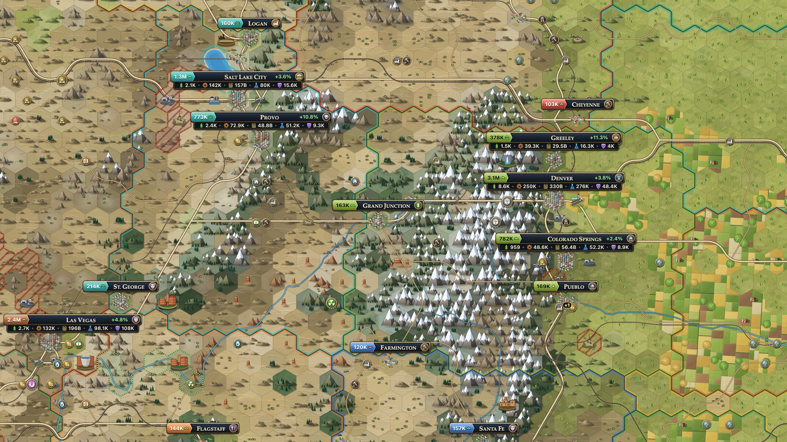

# EarthCiv: real countries as strategy maps, built from public data

**Live: [earthciv.org](https://earthciv.org/)** · [United States](https://earthciv.org/?country=us) ·
[Canada](https://earthciv.org/?country=ca) · [Add your map](#add-your-map)


EarthCiv draws real countries like a turn-based strategy map, from public data: terrain, cities, resources, roads
and more, with every number traced to its source. It is a visualizer, not a game.

- **It opens on a world map that lists the maps made in this style:** more than 40 maps of more than 50 countries
  and territories. About 40 people built most of them in the day after usaciv was announced. Each of their maps
  carries its author's name and a link to their repository, and most of those with a live site open inside EarthCiv.
- **Two countries are EarthCiv editions,** drawn by the map engine in this repository: the
  [United States](#the-united-states-edition) and [Canada](#canada-edition).

EarthCiv grew out of [usaciv](https://karpathy.ai/usaciv) by Andrej Karpathy
([announcement](https://x.com/karpathy/status/2125779541952246039)). His map of the United States is the first
edition here, and the Canada edition and the world map are built on his code.

## Add your map

If you built a map of a country, a region or a city in this style, it belongs on the
[world map](https://earthciv.org/). The first list came from a GitHub search for usaciv on November 26, 2026, so
your map may already be there. The search box at the top finds a map by its name, its author or its repository.

- **Not listed, or listed with a mistake?**
  [Fill in the map form](https://github.com/earthciv/earthciv/issues/new?template=add-your-map.yml). It asks for
  the map's name, its repository, its live address if it has one, and the places it covers. Use the same form to
  have a map taken off the list.
- **Prefer a pull request?** Add or edit your entry in [`web/data/ports.json`](web/data/ports.json). Its fields are
  described below.
- **Nobody has mapped your country yet?** Build the map, publish it anywhere, and add it the same way. Most authors
  started from usaciv's code, which this repository contains: [How it works](#how-it-works) describes the pipeline
  that turns public data into the files the map draws. [docs/EDITIONS.md](docs/EDITIONS.md) is the format a country
  follows to run on EarthCiv's own engine, as the United States and Canada do.

EarthCiv only points to your map. Your code and data stay in your repository, under your name and your licence.

<details>
<summary>The fields of an entry in the list</summary>

```json
{
  "id": "ptciv",
  "name": "Portugal (ptciv)",
  "emblem": "🇵🇹",
  "status": "live",
  "scope": "country",
  "region": "Europe",
  "countries": ["PT"],
  "center": [-8.0, 39.6],
  "languages": ["pt", "en"],
  "license": "MIT",
  "repo": "your-name/ptciv",
  "author": "your-name",
  "url": "https://your-name.github.io/ptciv/",
  "embed": true,
  "description": "Portugal as a hex strategy map, built from INE and Eurostat open data."
}
```

- `id` is unique: lowercase letters, digits and hyphens.
- `status` is `"live"` for a map with a public `https` address in `url`, and `"repo"` (with `"url": null`) for a map
  that has only source code.
- `embed` says whether EarthCiv may show your site in a frame on its own page. Use `false` to have your site open
  in a new tab instead, or if your host does not allow framing.
- `scope` is `"country"`, `"multi"` (several countries) or `"region"` (part of a country, such as a region or a
  city).
- `countries` holds ISO 3166-1 alpha-2 codes, and `center` is `[longitude, latitude]`.
- `region` is the part of the world the map belongs to, such as `Europe` or `Middle East`.
- `languages` holds the codes of the languages the map's text is in, such as `pt` or `zh-TW`.
- `repo` is `owner/name` on GitHub. `license` is the licence that repository states, or `null`.
- `emblem` is one emoji, usually a flag. `name`, `author` and `description` are plain text.
- For a new entry, also raise `CATALOG_PORT_COUNT` in `web/js/ext/ports/index.js` by one. Then run
  `uv run python -m unittest tests.test_ports`, which checks every entry.

</details>

## The United States edition

This is the map usaciv began with: the **real** United States drawn like a turn-based strategy map. Hex terrain comes
from elevation and land-cover data. Cities have yield banners built from GDP and job counts. Resources are real
power plants, mines and shale plays. Roads, railroads, ports, forts and wonders sit on the tiles. There are lenses,
a City View with citizens and districts, and a council of Advisors for slicing the data. Every number traces back
to a public source in the in-app **Almanac**.

It is a static site: plain ES modules and Canvas 2D, with no framework, no npm and no build step. The data is built
by a small Python pipeline that uses only the standard library, from public downloads that need no API keys.

<table>
  <tr>
    <td></td>
    <td></td>
  </tr>
  <tr>
    <td></td>
    <td></td>
  </tr>
</table>

### What's in it

- **The map.** Painted hex terrain: forests, crop patchwork, wooded hills, snowy ranges, Great Basin ranges and
  playas, Colorado Plateau mesas, marsh and suburbs. Coasts and lakes are smoothed. There are rivers and state
  colours. Cities grow from villages into skylines across several hexes. All art is drawn in code.
- **Yields.** The top bar and the city banners show Food, Production, Gold, Science and Culture. Gold is GDP from BEA.
  The others are job counts by industry from the ACS. Click a yield for a report with leaderboards.
- **Tile improvements.** Interstates and major highways, railroads, the principal ports (ranked by tonnage) and the
  busiest airports. Turn them on and off from the **Map** menu.
- **Military.** DoD installations are drawn as forts, one glyph per service, and the largest ranges as restricted
  ground. The Military advisor has troops and defense dollars by state.
- **Wonders.** 52 wonders, each chosen by a published rule: the most-visited national parks, the R1 universities
  with the most R&D, and a set of landmarks.
- **Trade routes.** The largest interstate freight flows between metro areas (FAF5) are drawn as caravan arcs.
- **Lenses.** Colour every county by income, degrees, poverty, growth, broadband, homeownership, land cover, faith,
  wellbeing, disasters, veterans and more. The legend is a histogram you can brush, and it states the caveats.
- **City View.** Click a city:
  - Its **citizens** appear as rows of little figures by occupation, age, commute, education and origin, so
    San Jose's row looks different from Elkhart's.
  - Its **districts** come from real industry specialisation (BLS QCEW location quotients): Campus, Commercial hub,
    Industrial zone, Harbor, Theater square, Aerodrome and others. It gets a city-type badge such as
    "Tech city" or "Motor city".
  - It also shows GDP by industry, the workforce, resource sites, peer cities and the metro's hexes on the map.
- **Advisors.** Docked dashboards for Energy & Resources, Economy, People, Prosperity & Housing, Knowledge, Land,
  Military, Commerce and Culture, each linked both ways with the map. The **Explorer** turns any column of
  states, metros or 3,100+ counties into a table and a scatter plot, and highlights your selection on the map.
- **Sharing and navigation.**
  - Every view has a link (the URL hash holds it), and share images are rendered off-screen.
  - Search with `/`; press `?` for keyboard help.
  - Works on phones.
- **Art gallery** at `/dev/art.html`: every terrain, city, water, icon, banner and map-layer specimen at four zoom
  levels, for working on the art.
- **Trailer maker** at `/dev/trailer.html`: renders a 30-second 1080p MP4 trailer of the map frame by frame,
  entirely in the browser (WebCodecs H.264 and AAC, and a small hand-written MP4 writer, with no tools to install).
  Its soundtrack is an original score synthesised in code with the Web Audio API and timed to the cuts
  (`web/dev/trailer/score.js`). The shots, captions, title and URL are in `web/dev/trailer/storyboard.js`.

## Canada edition

This copy's site opens on the world map (`data-home="world"` in `web/index.html`), where Canada and the United States
each have a Play button; they live at `?country=ca` and `?country=us`. Inside an edition, the top-left country switcher
switches between them and the **World** button beside it opens the world map. Old links without `?country=` (such as
`/#city=35620`) still open the United States (`data-default-country="us"`). The same map renderer covers all 10 provinces and 3 territories, with 2021 Census
urban areas (population from Statistics Canada's July 1, 2025 estimates), all five yields (GDP and workers by industry), 14 census-division and land-cover lenses, power plants and
mines, oil and gas fields, highways and railways, ports and airports, freight routes between provinces (Commerce
advisor), Canadian Forces bases and where serving members and veterans live (Military advisor), wonders (Parks Canada's most-visited parks, canals and historic
sites, and the universities with the most doctoral students), natural disasters since 1980 (Culture advisor), and
the City View (click a city for its
districts, citizens and resource sites, from the 2021 Census). Open **Advisors → Energy & Resources** to search and
filter the mapped sites, or **Almanac → Sources** to trace the data. It follows the U.S.
edition's map rules: sites on water snap to land, every city has its own banner hex, and lens colours use the same
percentile ranges.

The Canadian data ships with the site. For the source tables, geographic conventions, and rebuild command, see
[Canada edition data and rebuild](docs/CANADA.md).

## Quick start

You need [uv](https://docs.astral.sh/uv/), which fetches a suitable Python for you (3.11+). Nothing else needs
installing.

```bash
uv run python -m pipeline serve        # http://127.0.0.1:8765
```

The built data (`web/data/`, about 6 MB) is included, so that is all it takes to run it. `web/` is a self-contained
static site that you can upload to any static host (Netlify, S3, GitHub Pages…).

To make a deploy package:

```bash
uv run python -m pipeline package      # → usaciv.zip: one file to upload
```

`usaciv.zip` unzips to a `usaciv/` folder: `web/` without the dev pages, plus `usaciv-source.zip`: this whole project, minus downloads and
caches, which the in-app help links to. If you publish your own copy, change the address `earthciv.org` in
`web/index.html` (the social-card tags), in `SITE_URL` in `web/js/app/project.js` (printed on share images) and in
`web/dev/trailer/storyboard.js`.

To rebuild the data from the original publishers:

```bash
uv run python -m pipeline all          # download (cached) → process → build web/data/*.json → check
```

The first full run downloads about 500 MB into `data/raw/` (not included in the source zip). Later runs reuse the cache.

## How it works

```
pipeline/
  core/       shared plumbing: cached downloads with a provenance manifest (fetch.py), the Source base class,
              projection (geo.py), hex grid (hexgrid.py), atomic JSON IO (store.py)
  sources/    one module per data source: fetch() raw files, process() → data/interim/<id>.json
  build/      builders that put the sources onto the hex map → web/data/*.json
  check.py    validates web/data against docs/DATA_CONTRACTS.md and prints a data-quality report
tests/        unittest suite (standard library only)
web/
  js/         boot.js (entry: the world map or an edition), main.js (an edition's app shell), camera, hex grid
              (mirrors pipeline/core/hexgrid.py), render/ (map layers, banners, off-screen snapshots) and render/art/
              (all the tile art), ui/ (panels, lenses, Almanac, minimap), app/ (app API, search, sharing, URL state,
              home page), ext/ (extensions: City View, Advisors, map layers, the world map)
  data/       the generated JSON the browser loads
  dev/        the art gallery
docs/         DATA_CONTRACTS.md: the shape of every web/data file, shared by pipeline and browser
```

The flow is always **source → interim → builder → web/data**:

- **Sources** know nothing about hexes or the UI. Each one turns a publisher's files into tidy JSON. Any `Source`
  subclass with a `SourceInfo` is discovered automatically.
- **Builders** put that data onto the shared 25 km hex grid (an Albers equal-area projection). They declare
  `REQUIRES` and `PRODUCES`, run in dependency order and are skipped when they are up to date. A builder may define
  `check(web_dir)` to add its own lines to the data-quality report.
- **`catalog`** writes `sources.json` from the source registry and the download manifests (URL, sha256, size and
  date of every file). That is the Almanac's bibliography, so provenance stays accurate automatically.
- **`check`** is the gate: every line is PASS, NOTE, WARN or FAIL, and any FAIL exits 1.

The browser side has a small app API (`web/js/app/api.js`, documented in `docs/DATA_CONTRACTS.md`). The City View,
the Advisors and the map layers are all **extensions** built on it, and so can anything you add:
- `registerStaticLayer` draws into the cached map.
- `registerOverlay` draws per frame.
- `registerMode` and `ui.dock` give you a docked screen.
- `addMapToggle` adds a switch to the Map menu.
- `loadData` lazy-loads a data file.
- `setHighlight` links a view to the map.

### Commands

```bash
uv run python -m pipeline list                        # sources and builders (in build order)
uv run python -m pipeline fetch [source …]            # download raw files (cached; --force re-downloads)
uv run python -m pipeline process [source …]          # raw → data/interim/<source>.json
uv run python -m pipeline build [builder …]           # interim → web/data; up-to-date builders are skipped
uv run python -m pipeline build cities --deps         # …also run the builders `cities` depends on
uv run python -m pipeline build --force               # rebuild everything
uv run python -m pipeline check                       # validate web/data + data-quality report (exit 1 on FAIL)
uv run python -m pipeline all [--offline]             # fetch + process + build + check
uv run python -m pipeline serve [--port 8765]         # serve web/
uv run python -m pipeline package                     # usaciv.zip: the site to upload, with the source inside
uv run python -m unittest discover -s tests           # tests
```

`--offline` never touches the network: it uses the newest complete cached release of each source.

### Adding a data source

1. Create `pipeline/sources/<name>.py` with a `Source` subclass. Give it a `SourceInfo` (title, publisher,
   license, description, what it's used for), a `fetch()` that calls `self.download(url, filename)`, and a
   `process()` that returns a dict.
2. Use it from a builder: extend an existing one or add a module to `pipeline/build/` with `REQUIRES`, `PRODUCES`
   and `build()`. A new lens is just another entry in `lenses.json`. Document any new file shape in
   `docs/DATA_CONTRACTS.md`.
3. Run `uv run python -m pipeline fetch <name> && uv run python -m pipeline process <name> && uv run python -m pipeline build --deps <builder> && uv run python -m pipeline check`.

## Data sources

All are public and none needs an API key: 31 sources in all. The Almanac (open it from the top bar) lists the exact
files, URLs, checksums and caveats.

| Source | Publisher | Used for |
|---|---|---|
| Cartographic boundaries 2023, 1:20M | U.S. Census Bureau | Land vs. water, state borders, county lookup |
| Gazetteer 2024 | U.S. Census Bureau | City locations, county land area |
| CBSA delineation files, July 2023 | Census / OMB | Metro member counties, principal cities |
| American Community Survey 1-year (2025) | U.S. Census Bureau | City and state yields and panels, citizens, the national top bar |
| American Community Survey 5-year (2024) | U.S. Census Bureau | County lenses, veterans |
| Population estimates (vintage 2025) | U.S. Census Bureau | Population growth, yearly metro population |
| CAGDP2, GDP by county and industry | Bureau of Economic Analysis | Gold yield (GDP), GDP by industry |
| ETOPO1 via ERDDAP | NOAA NCEI | Relief, hill-shading, ocean depth |
| NLCD 2021 | USGS / MRLC | Land cover |
| Natural Earth 1:50m and 1:10m | Natural Earth | Neighbouring countries, lakes, rivers, roads, railroads |
| EIA-860M generator inventory | Energy Information Administration | Power plants |
| Mine-level coal production | Energy Information Administration | Coal mines |
| Mines data set | Mine Safety and Health Administration | Mine locations, metal mines |
| Tight oil & shale gas plays | Energy Information Administration | Oil and gas resources |
| QCEW annual averages by county | Bureau of Labor Statistics | Districts and city-type badges |
| Principal Ports of the United States | U.S. Army Corps of Engineers | Ports |
| Enplanements, all-cargo data, NASR | Federal Aviation Administration | Airports |
| Freight Analysis Framework FAF5 | FHWA / BTS | Trade routes |
| MIRTA installations and ranges, FY2025 | Department of Defense | Forts, restricted ground |
| Personnel by duty state | Defense Manpower Data Center | Troops by state |
| Defense Spending by State | DoD Office of Local Defense Community Cooperation | Defense dollars by state |
| Park boundaries; Visitor Use Statistics | National Park Service | Park wonders, protected land |
| National Historic Landmarks | National Park Service | Landmark wonders |
| IPEDS directory and enrollment | NCES, Department of Education | Universities |
| HERD Survey | National Science Foundation (NCSES) | Universities ranked by R&D |
| 2020 U.S. Religion Census | ASARB, distributed by ARDA | Faith lenses |
| PLACES county data | CDC | Wellbeing lens |
| Disaster Declarations Summaries | FEMA (OpenFEMA) | Disasters lens |
| Billion-Dollar Weather and Climate Disasters | NOAA NCEI | Billion-dollar disasters by state |

The world map (the home page, and the **World** button inside an edition) shows every EarthCiv edition and community
map listed in `web/data/ports.json`. Every country can be clicked, on the map, in the list beside it or through its
search box: its card has a button that opens its map, and its population, GDP per person and life expectancy from the World
Bank's [World Development Indicators](https://datacatalog.worldbank.org/search/dataset/0037712) (CC BY 4.0). Each figure
is the newest the World Bank has for that country, labelled with its year. `uv run python -m pipeline.build_world_figures`
rebuilds `web/data/world-figures.json` (add `--refresh` to download newer figures).

### Reading the map honestly

The map is drawn to be fun, but the numbers are real, so it is worth knowing where the game metaphor stops:

- **Yields are names given to real figures.** Gold is GDP. Food, Production, Science and Culture are job counts by
  industry, counted where people live.
- **Positions are schematic.** Each hex is about 1,600 km² and shows the place it covers. District plaques show
  what a metro specialises in, not where in the metro those jobs are. Roads and rail are generalised line work.
- **Missing data stays missing:** it is null, never 0. Where a publisher suppresses a figure, the map says so or
  marks the estimate (≈).
- **Selections are rules, not opinions.** Wonders, forts and trade routes are picked by rules that are published
  inside the data files and shown in the app.
- **Every lens states its caveat.** For example, the Religion Census counts congregations' adherents, not what
  residents believe, and covers about half the population.

### Credits and terms

The code is MIT-licensed (see [LICENSE](LICENSE)). That licence covers the code only, not the data. Most of the
data comes from U.S. federal agencies and is in the public domain. Natural Earth is public domain. The faith lenses
are figures derived from the 2020 U.S. Religion Census (© 2022 ASARB). They are used under the ARDA usage terms,
which ask for credit to the Association of Statisticians of American Religious Bodies and the Association of
Religion Data Archives. Please keep that credit if you reuse them.

The community maps on the world map belong to their authors. Each keeps its own licence, which
`web/data/ports.json` records where the map's repository states one. EarthCiv links to those maps and copies none of
their code or data.

The look is inspired by turn-based 4X strategy games, but every glyph, icon and texture here is original and drawn
in code. This project is not affiliated with or endorsed by any game publisher.

## Ideas

- A county-level elections lens.
- Alaska and Hawaii insets, so the whole country is on the map.
- USDA crops as agricultural resources.
- A county "Specialisation" lens from `districts.json`.
- A time slider: yearly population (2020 onwards) is already in `cities.json`, and BEA has GDP history.

Forks and experiments are welcome. If yours becomes a map, [add it to the world map](#add-your-map).
